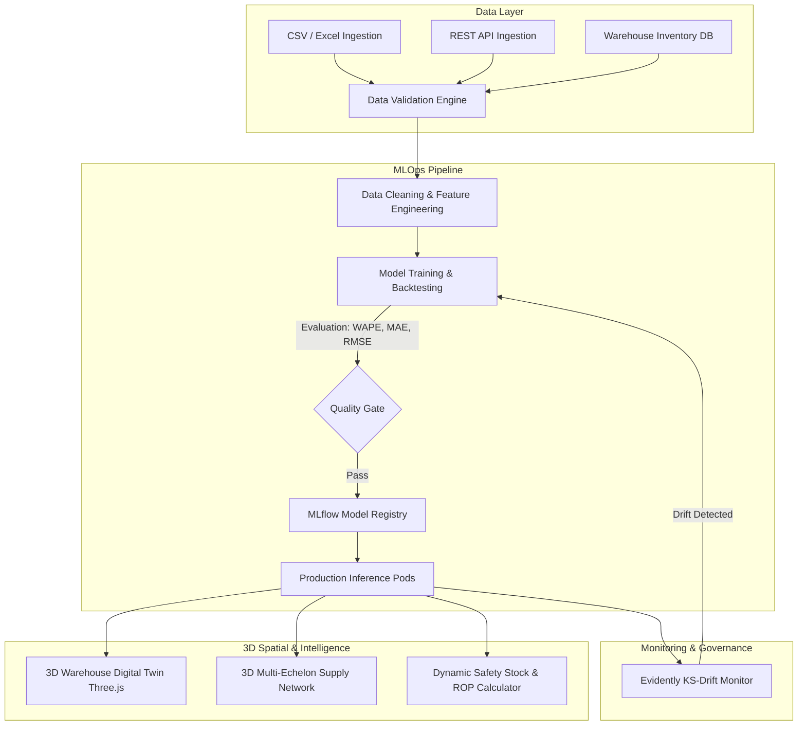

# DemandFlow AI

> **Project Title:** Design and Development of an MLOps-Driven Predictive Analytics Framework for Intelligent Product Demand Forecasting  
> **Platform Name:** DemandFlow AI — Intelligent 3D Warehouse Intelligence & MLOps Forecasting Platform

---

## 🚀 Overview

**DemandFlow AI** is an enterprise-grade predictive analytics and MLOps platform engineered to transform supply-chain demand planning. By unifying high-precision machine learning forecasting, 3D warehouse digital twin spatial visualization, and automated continuous-learning MLOps pipelines, DemandFlow AI empowers supply chain managers to eliminate stockouts, minimize excess holding costs, and monitor model performance in real time.

---

## 🏛️ System Architecture



---

## ✨ Key Features & Capabilities

### 1. 🏢 3D Spatial Warehouse Digital Twin
- **Interactive 3D Racking Systems:** Real-time spatial representation of warehouse bays, multi-level shelves, pallets, and carton boxes.
- **Raycast Section Inspection:** Click on any shelf bay to inspect current stock levels, capacity utilization, SKU mix, and low-stock warnings.
- **Visual Modes:** Realistic Material View, Stockout Risk Heatmap, and Structural Wireframe.
- **Demonstration Hubs:** Pre-configured for **ABC Retail Distribution** across four Maharashtra strategic nodes:
  - **Nagpur Central Logistics Hub** (150,000 sq ft)
  - **Pune High-Tech Distribution Center** (120,000 sq ft)
  - **Mumbai Harbor Fulfillment Port** (200,000 sq ft)
  - **Nashik Agro & Retail Facility** (85,000 sq ft)

### 2. 🌐 3D Supply Chain Network Topology
- Interactive spatial network mapping: `Suppliers → Central Strategic Hub (Nagpur) → Regional Facilities → Distribution Channels`.
- Animated spline particle flows representing material throughput and delivery frequency.
- Live bottleneck detection highlighting congested transit lanes and critical nodes.

### 3. 🧠 Machine Learning Forecasting Engine
- **Supported Algorithms:**
  - **Meta-Ensemble:** Weighted blend of Gradient Boosted Trees, Random Forest, and 7-day Seasonal Naive.
  - **Gradient Boosted Trees (XGBoost/LightGBM style):** Non-linear temporal pattern capture.
  - **Random Forest Regressor:** Robust non-parametric tree ensemble.
  - **Seasonal Naive:** 7-day cyclical heuristic reference baseline.
- **Chronological Validation:** Rolling-origin backtesting without look-ahead data leakage.
- **Evaluation Metrics:** WAPE (Weighted Absolute Percentage Error), MAE, RMSE, MAPE, and R² score.
- **Multi-Horizon Predictions:** 7, 14, 30, 60, and 90-day forecasts with 90% confidence bands.

### 4. 📦 Intelligent Inventory Replenishment & Optimization
- **Dynamic Safety Stock ($SS$):** $SS = Z \times \sqrt{L} \times \sigma_d$ (configured for 95% cycle service level, $Z=1.65$).
- **Reorder Point ($ROP$):** $ROP = (\bar{d} \times L) + SS$.
- **Economic Order Quantity ($EOQ$):** Automated optimal batch sizing balancing ordering vs. inventory holding costs.
- **Shortage Prediction:** Early warning alerts for SKUs whose on-hand inventory falls below lead-time consumption.

### 5. 🔄 Production MLOps & MLflow Lifecycle Management
- **Automated 9-Stage Pipeline:** Ingestion → Validation → Cleaning → Feature Engineering → Training → Evaluation → Registry → Deployment → Monitoring.
- **Model Registry & Versioning:** Track model lineages (`v1.0.0`, `v2.3.1`, `v2.4.0`) with staging transitions (`Production`, `Staging`, `Archived`).
- **Canary Deployments & Rollbacks:** Zero-downtime model promotion and one-click instant rollbacks to validated historical models.
- **Continuous Monitoring:** Real-time data drift (Kolmogorov-Smirnov feature tests), prediction drift, API latency tracking, and automatic retraining triggers.

---

## 🛠️ Technology Stack

| Layer | Technologies |
|---|---|
| **Frontend** | React 19, TypeScript, Vite, Tailwind CSS 4, Lucide Icons, Recharts, Framer Motion |
| **3D Graphics** | Three.js, WebGL, Raycasting, Perspective Camera Controls |
| **Backend API** | Python 3.11+, FastAPI, Uvicorn, Pydantic v2 |
| **Machine Learning** | Scikit-learn, Pandas, NumPy, Mathematical Inventory Optimization |
| **Database & Auth** | Convex Database, Reactive Client, Convex Auth |
| **Infrastructure** | Docker, Docker Compose, GitHub Actions CI/CD |

---

## 🚦 Getting Started

### Prerequisites
- **Node.js** (v18 or higher) & **npm**
- **Python** (3.10 or higher) & **pip**

### 1. Clone the Repository
```bash
git clone https://github.com/samyak-ai16/MLOps_demand_forecast.git
cd MLOps_demand_forecast
```

### 2. Frontend Setup
```bash
# Install frontend dependencies
npm install

# Start Vite development server
npm run dev
```
The frontend will be accessible at: `http://localhost:5173`

### 3. Backend Setup
```bash
# In a separate terminal, install backend requirements
pip install -r backend/requirements.txt

# Run the FastAPI server
cd backend
python run.py
```
The FastAPI documentation (Swagger UI) will be accessible at: `http://localhost:8000/docs`

---

## 🐳 Docker Deployment

To launch the full containerized stack:
```bash
docker-compose up --build
```
- **Web Dashboard:** `http://localhost:3000`
- **FastAPI Backend:** `http://localhost:8000`

---

## 📡 REST API Reference

| Method | Endpoint | Description |
|---|---|---|
| `GET` | `/health` | Service health status and database statistics |
| `GET` | `/api/companies` | List enterprise companies |
| `GET` | `/api/warehouses` | List distribution facilities and utilization |
| `GET` | `/api/products` | Retrieve catalog items and on-hand inventory |
| `POST` | `/api/datasets/upload` | Upload and validate CSV/Excel demand datasets |
| `POST` | `/api/forecast` | Generate multi-horizon ML demand forecast |
| `GET` | `/api/inventory/recommendations` | Compute safety stock, ROP, and replenishment orders |
| `GET` | `/api/models` | List MLflow registered models and deployment stages |
| `POST` | `/api/models/{id}/deploy` | Promote model candidate to Production stage |
| `POST` | `/api/models/{id}/rollback` | Rollback production serving to prior stable version |
| `GET` | `/api/experiments` | View MLflow backtesting runs and hyperparameters |
| `GET` | `/api/pipelines` | View automated retraining pipeline execution history |
| `POST` | `/api/pipelines/run` | Trigger on-demand end-to-end retraining run |
| `GET` | `/api/monitoring` | Real-time feature drift and accuracy metrics |
| `GET` | `/api/alerts` | Active stockout, drift, and pipeline notifications |
| `POST` | `/api/whatif` | Simulate pricing and promotional demand elasticity |

---

## 🛡️ License
Designed and developed for academic research, enterprise MLOps demonstration, and professional portfolio presentation.
